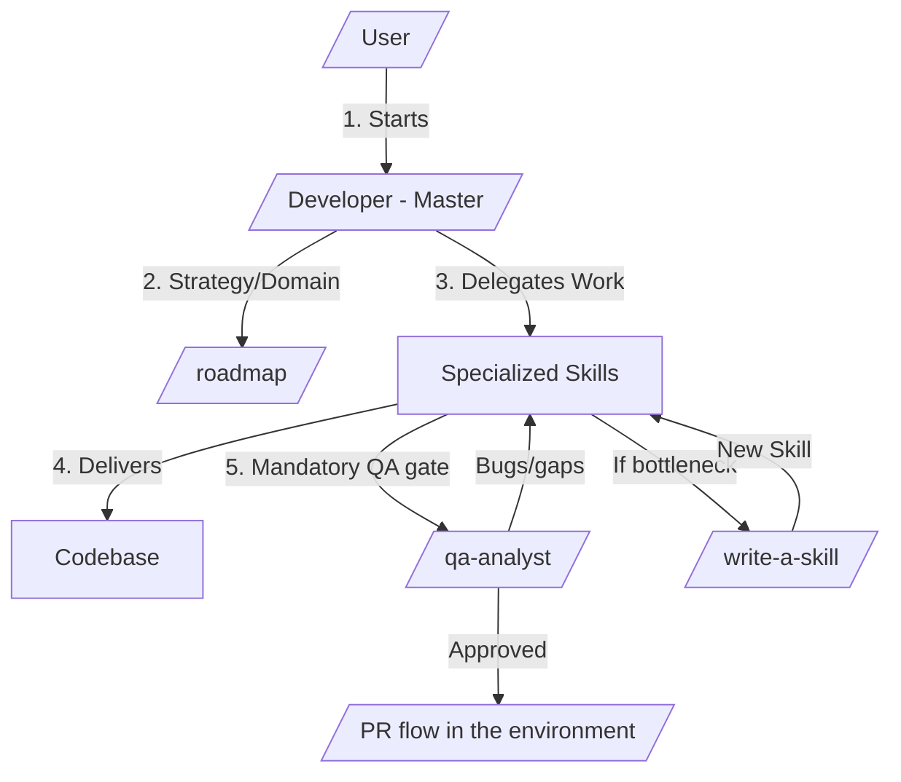

# Skill Governance

Skills are organized into bucket folders under `skills/`:

- `engineering/` - day-to-day code work
- `productivity/` - workflow tools not tied to code
- `misc/` - maintained but rarely used
- `personal/` - tied to personal setup, not promoted
- `in-progress/` - drafts not ready for distribution
- `deprecated/` - retired

Every skill under `engineering/`, `productivity/` or `misc/` must be referenced in the root `README.md` and listed in `.claude-plugin/plugin.json`. In practice the `plugin.json` entry is what counts: after adding or changing a skill, `node scripts/build-catalog.mjs` regenerates `SKILLS.md` and `llms.txt`, which are derived and must not be edited by hand. Skills under `personal/`, `in-progress/` and `deprecated/` must not appear in either.

## Harness neutrality

A skill's content (`SKILL.md` and support files) must not name mechanisms exclusive to Claude Code - for example the `Agent` tool, `subagent_type=Explore` or the `Task` tool. Describe the shape of the delegation (e.g. "spawn subagents in parallel", "read-only exploration subagent") and leave the mechanism to whichever harness is running (Claude Code, Codex, Hermes).

Every distributed skill must have an `agents/openai.yaml` next to its `SKILL.md`, with `interface.display_name` and `interface.short_description` for the Codex picker. Skills whose `SKILL.md` sets `disable-model-invocation: true` (or that are inherently harness-specific, such as `git-guardrails-claude-code`) must mirror that with `policy.allow_implicit_invocation: false`.

## Agentic workflow protocol (`developer`)

This repository uses a hierarchical delegation model focused on compliance:

1. **Entry**: `developer` audits the environment (phases 1-4).
2. **Delegation**: `developer` acts as the Architect (it does not run heavy code work).
3. **Execution**: delegates to specialized skills (`diagnose`, `tdd`, etc.).
4. **QA gate (mandatory)**: at the end of any development - at every risk tier, without exception - `developer` **must** invoke the `qa-analyst` skill to analyze the generated/changed code before opening the PR. Bugs or gaps found reopen the DAG as new tasks; only after QA analysis approves may the PR flow available in the environment be triggered. Never invoke a PR skill that is not installed.
5. **Expansion**: unmapped bottlenecks -> automatic invocation of `write-a-skill`.

## System architecture

