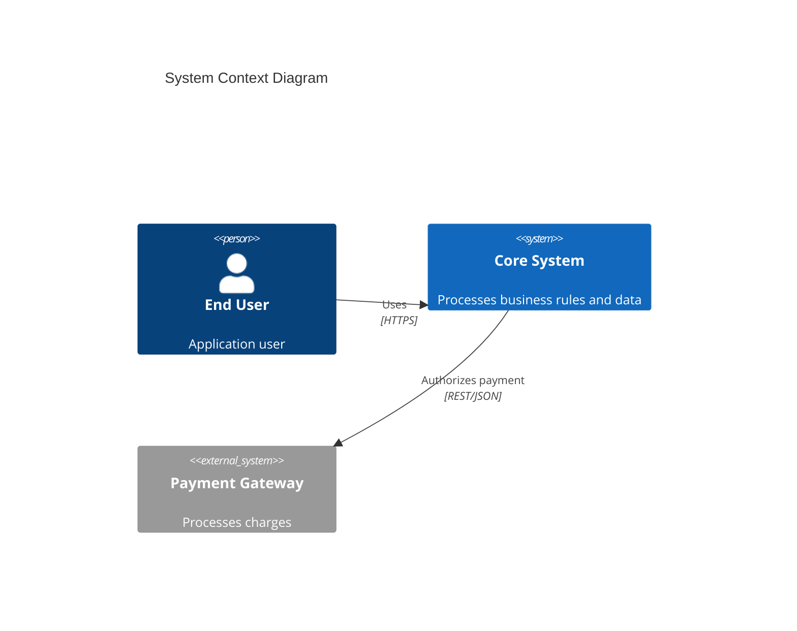
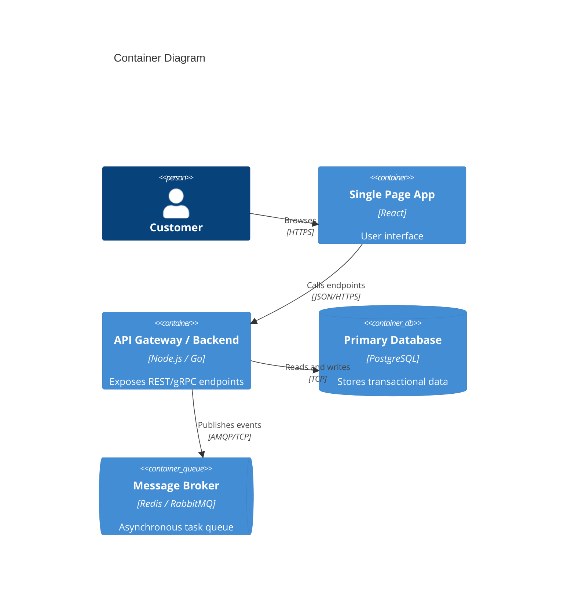

# Template: Architecture Design Document (ADD / SAD)

Use this template to create the master document at `docs/architecture/ADD.md`.

```markdown
# Architecture Design Document (ADD) - [Project Name]

## 1. Overview and Business Context
- **Objective:** What this system solves and which value it delivers to the business.
- **Project scope:** System boundaries, user personas and critical flows.
- **Stakeholders:** Teams involved, customers and consuming systems.

## 2. Non-Functional Requirements (NFRs) and Constraints
- **Scalability and load:** e.g. support up to 5,000 RPS with p95 < 200ms.
- **Availability:** e.g. 99.9% uptime with multi-AZ failover.
- **Security & compliance:** GDPR/LGPD, encryption at-rest/in-transit, auditing and RBAC.
- **Cost/FinOps:** cloud infrastructure budget constraints.

## 3. Patterns and Architectural Style
- **Main pattern:** (e.g. Clean Architecture, Modular Monolith, Event-Driven, Microservices).
- **Rationale:** Why this pattern meets the NFRs better than the alternatives.
- **Code conventions:** Folder structure, layers and responsibility boundaries.

## 4. Architecture View (C4 Model)

### 4.1 C4 Level 1 - Context Diagram


### 4.2 C4 Level 2 - Container Diagram


## 5. Data and Persistence Strategy
- **Primary databases:** Selected technologies and data model.
- **Multitenant isolation:** Strategy (e.g. Row-Level Security vs Database per Tenant).
- **Consistency:** ACID model for critical transactions and eventual consistency for reads/reports.
- **Caching strategy:** TTL policies, invalidation and technologies (e.g. Redis).

## 6. Communication, APIs and Integrations
- **Public/private APIs:** REST (OpenAPI 3.0), gRPC or GraphQL.
- **Asynchronous messaging:** Topics, dead-letter queues (DLQ), idempotency and retry policies.
- **API security:** OAuth2, JWT bearer tokens, API keys, rate limiting.

## 7. Infrastructure and Deployment
- **Cloud provider:** AWS / GCP / Azure / On-premise.
- **Network topology:** VPC, public/private subnets, load balancer, Cloudflare/WAF.
- **Deployment strategy:** Docker containers, orchestration (Kubernetes / ECS / Fly.io), blue/green deploy.
- **CI/CD:** Automated test pipelines, static analysis and continuous deployment.

## 8. Observability and Operations
- **Structured logs:** JSON format with `correlation_id` / `trace_id` propagated.
- **Metrics & dashboards:** Prometheus / Datadog / Grafana (golden signals: latency, traffic, errors, saturation).
- **Distributed tracing:** OpenTelemetry.
- **Alerts:** Notification channels for critical incidents.

## 9. Anticipated Risks and Technical Debt
- Known architectural risks and mitigation plans.
```
