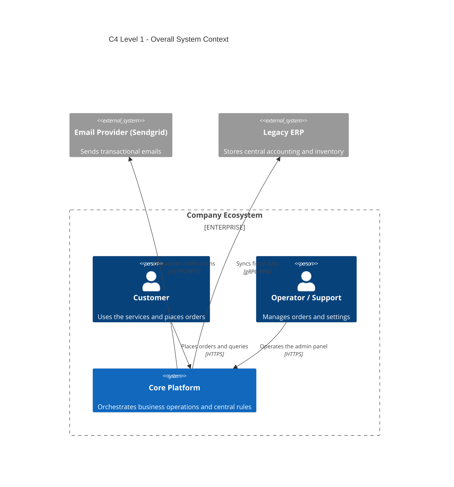
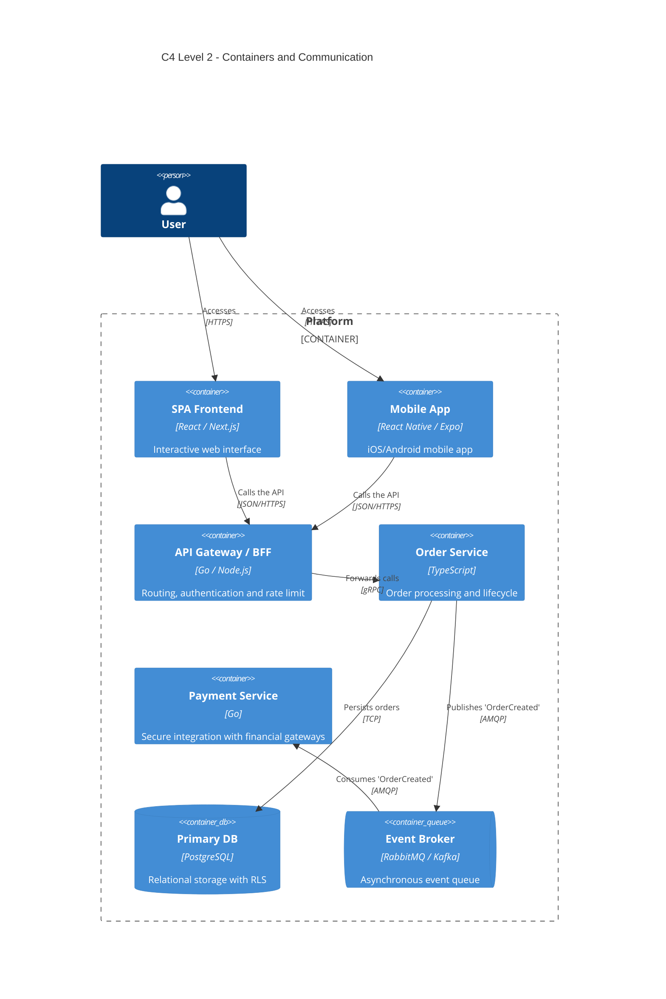
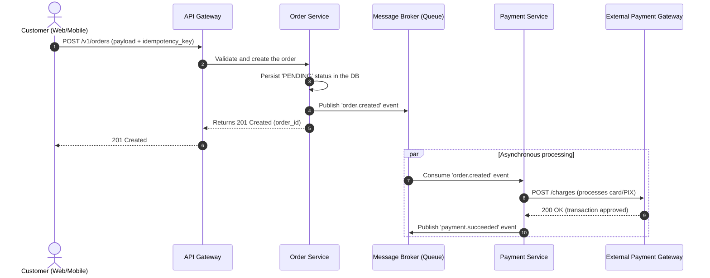
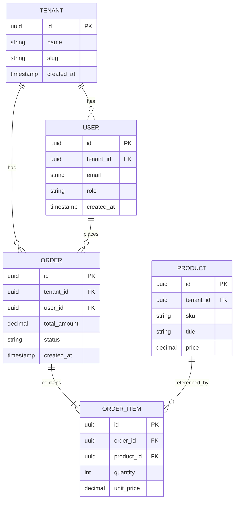

# Diagram Reference: C4 Model, Sequence and DER

Use Mermaid diagrams in every architectural document so they render natively in Markdown on GitHub/GitLab and in code documentation.

---

## 1. C4 Model (Context and Containers)

### C4 Level 1 - System Context
Shows the system boundaries, its users and external systems.

---

### C4 Level 2 - Containers
Reveals the applications, databases, microservices and messaging.

---

## 2. Sequence Diagram (Flows and Protocols)

Essential to make synchronous calls, asynchronous calls, webhooks and idempotency explicit.

---

## 3. Entity-Relationship Diagram (DER / data schema)

